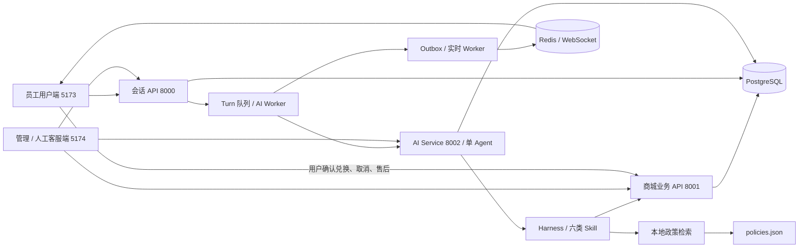

# 积分福利商城智能客服：初版架构与验收

更新日期：2026-11-01。本项目依据有分公开业务场景设计；模拟企业、员工、积分与交易规则仅供本地演示。政策资料采集日期保留为原始整理日期，不因本次代码验证而更新。

## 当前架构

保留单 Agent，通过 Skill 动态切换工具范围，支持一次问题中连续查询多个领域。Skill 是领域指引及工具清单，不是独立 Agent。

企业、福利项目和用户身份来自服务端签名令牌，业务工具不能通过模型参数切换身份。商品池、积分、订单、会话、人工工单、后台统计、运行审计和消息频道均按授权范围隔离。商品库存为演示商城共享库存，项目可分别配置积分价及个人限额。

## 六类 Skill 与十四个工具

Skill 定义在 `ai-service/atguigu/agent/harness/skills/catalog.py`；工具统一注册在 `harness/tools/catalog.py`。

| Skill | 代码 | 可用领域工具 |
| --- | --- | --- |
| 商品 | `product-service` | `search_products`、`get_product`、`get_product_stock`、`quote_redemption` |
| 订单 | `order-service` | `list_orders`、`get_order` |
| 物流 | `logistics-service` | `list_orders`、`get_order`、`get_logistics` |
| 售后 | `aftersales-service` | `get_order`、`list_after_sales` |
| 政策 | `policy-service` | `search_knowledge` |
| 积分 | `points-service` | `get_points_account`、`list_points_transactions`、`get_expiring_points`、`get_points_refund_status`、`quote_redemption` |

去重后，原有九个工具为 `search_products`、`get_product`、`get_product_stock`、`list_orders`、`get_order`、`get_logistics`、`list_after_sales`、`search_knowledge`、`load_skill`。新增五个工具为积分 Skill 中列出的五个。`load_skill` 始终可用；没有激活 Skill 时仅开放该路由工具。

以上工具均查询信息或加载指引。兑换、取消、地址修改、售后申请和人工退分由页面调用业务 API，不能由 Agent 直接执行。

## Harness 在哪里

目录为 `ai-service/atguigu/agent/harness/`，装配入口为 `ai-service/atguigu/agent/factory.py`。

| 组件 | 主要文件 | 职责 |
| --- | --- | --- |
| 上下文与身份 | `run/context.py`、`run/runtime.py` | 历史消息裁剪、文本/对象消息规范化、可信身份及项目上下文 |
| 运行生命周期 | `run/coordinator.py`、`run/executor.py` | 创建 Run、调用模型、有限纠错、超时、状态与 Token 统计 |
| 动态能力范围 | `skills/catalog.py`、`skills/middleware.py`、`dynamic_prompt.py` | 加载领域指引，限制每次模型调用可见工具，支持跨领域切换 |
| 工具执行 | `tools/executor.py`、`tools/output.py`、`tools/snapshot.py` | 统一业务错误和结构化返回，保留工具调用及快照证据 |
| 积分工具 | `tools/points.py` | 账户、流水、临期、退分状态及业务端兑换预检 |
| 知识适配 | `knowledge/service.py`、`knowledge/retrieval.py` | 读取本地政策，按企业、项目、有效期及指定参考单位过滤 |
| 输出与事实校验 | `validator/output.py`、`validator/evidence.py`、`rules/fact.py` | 结构校验，校验引用的工具实体、字段、数值和单位，校验政策编号 |
| 页面动作 | `rules/action.py`、`validator/action.py`、`run/output.py` | 校验动作白名单、对象证据，映射为前端可识别入口 |

积分证据字段为 `business_facts`，引用成功工具调用的 `evidence_id`、具体实体和字段；规则解释附 `knowledge_references`，服务端映射为可展开的来源信息。该校验约束结构化证据和可识别的积分数字，不能视为对所有自然语言语义的完整证明。

每轮 Agent 生成最多16次工具调用，最多两轮生成（含首次），生成与纠错合计120秒超时。默认 Prompt 版本为 `welfare-support-v1`，审计保留历史版本。

## 商城业务改造落点

核心目录为 `backend/ecommerce-service/ecommerce_service/`。

- `models.py`：企业、福利项目、项目成员与商品池，积分账户、批次、流水、订单分配、退分和幂等记录。
- `welfare.py`：兑换预检、锁定账户与库存、按到期顺序扣批次、事务内生成订单与流水、整单退分。
- `welfare_app.py`：演示账号授权、商城查询、积分及兑换接口、员工确认操作、工作人员核对退分。
- `expiry.py`：每60秒结算到期批次，重复执行不重复扣分；查询可用余额时即时排除过期积分。
- `migrate.py`、`welfare_seed.py`：增量迁移与幂等演示初始化，旧现金订单归入 `legacy`，重启不重复发分。

写操作必须携带幂等键，业务层校验同一键的操作及参数指纹。重复提交不会重复扣分或重复退分；同一键换参数返回冲突。预检不扣分、不锁库存，正式提交时重新校验。

退分沿用原批次期限，返回三个独立字段：`returned_points` 为已退总额，`expired_points` 为退回时原批次已过期的部分，`usable_returned_points` 为退回时可用部分。后者仍可能随后到期，当前可用余额以账户查询为准。售后受理、订单取消和退分完成分别记录。

客服服务保留 Turn 调度、租约、人工接管和 Outbox，补入企业及项目隔离；Redis/WebSocket 频道同时包含企业与项目。人工客服可查看当前会话员工的积分快照。

## 独立政策资料

人工阅读文件为 [`../knowledge/policies/政策与规则知识库.md`](../knowledge/policies/政策与规则知识库.md)，运行文件为同目录 `policies.json`。

共18条：6条公开参考、9条通用演示规则、3条项目专属演示规则。公开资料包含有分客户案例及其他平台的可查询规则，保留来源链接、版本、采集日期与适用范围。其他平台规则不自动作为模拟企业承诺，未披露的额度、有效期和退分时限不补写为真实制度。管理员和客服可在“政策知识库”查看当前范围内容。

第一版使用本地结构化规则检索，尚未连接向量检索、重排和上传索引服务；`KnowledgeQueryService` 保留后续替换位置。

## 本地演示步骤

1. Docker Desktop 启动后，在项目根目录执行 `docker compose up -d --wait --wait-timeout 180`。
2. 打开员工端 <http://127.0.0.1:5173>，选择 `user_002`、年度员工福利；进入“积分”查看账户和临期批次。
3. 在客服界面询问“我的可用积分多少，未来30天多少积分到期？”或“年度福利积分有效期多久，取消订单如何退分？”。
4. 切换生日专属福利，询问“我的生日福利积分有多少，可以兑换什么商品？”，或在商城进入蛋糕兑换预检。确认兑换会实际扣减演示积分并生成订单。
5. 选择 `user_001` 查询 `ORDER_A_003`，观察“已取消但退分待核对”；不要仅凭取消状态判断到账。
6. 打开后台 <http://127.0.0.1:5174>，管理员查看政策、Run 与工具结果，在“订单退分”人工核对后处理。处理会持久保存，重启不重置。
7. 员工请求人工客服后，后台选择 `agent_001` 接入、回复并结束服务；结束后会话交还 AI。
8. 员工切换 `user_003`，后台切换 `admin_002` 或 `agent_002`，查看企业B独立项目、商品与数据。

演示初始值随实际兑换、退分和时间变化，余额及库存以当前页面为准。示例账号选择和免密登录仅用于本地演示。

## 2026-11-01 验证记录

| 验证 | 结果与范围 |
| --- | --- |
| 商城/客服/AI HTTP 集成 | `tests/test_welfare_api.py`：7项通过，覆盖跨企业与项目拒绝、并发幂等兑换、取消及人工退分、余额库存恢复、政策及会话权限 |
| Harness 单元 | `tests/test_harness.py`：9项通过，覆盖错误实体/单位、虚假政策引用、未退却声称已退、过期部分误报可用、政策范围 |
| 积分领域 | `tests/test_points_domain.py`：2项通过，覆盖到期幂等，以及混合有效/过期批次退分、库存恢复与防重复；全部事务回滚 |
| 基础连通 | `docker/check-services.py`：三个 API、两个前端和跨服务鉴权通过 |
| 真实模型 | `tests/check_live_chat.py`：余额临期、政策、退分核查、兑换预检、生日复合查询、转人工六类场景通过 |
| 人工客服与实时隔离 | `tests/check_scoped_realtime.py`：同企业接入回复、跨企业拒绝、消息仅送达对应企业、结束后回到 AI 通过 |
| 浏览器界面 | `tests/check_browser.py`：员工/项目切换、生日商品池、兑换确认页、政策库、退分工作台、企业B切换通过，无未捕获 JS 异常 |
| 前端构建 | 用户端及后台 `npm run build` 通过 |

API 测试订单会取消或退分，恢复对应余额与库存，审计记录保留；真实模型验证会留下聊天与 Run 记录。浏览器测试使用专用配置目录，先清理两个演示站点缓存，不使用个人浏览器资料。上述验证不代表生产自动解决率、准确率或线上延迟指标。

初版范围为单 Agent、纯积分实物兑换、单商品订单、整单退分和本地政策检索。多 Agent、混合支付、卡券、部分退款、供应商对接、向量 RAG、在线评测与训练微调留待后续版本。
