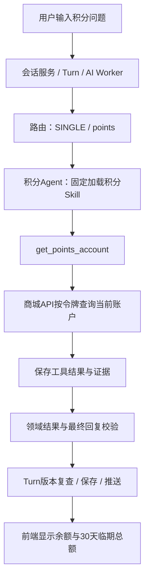
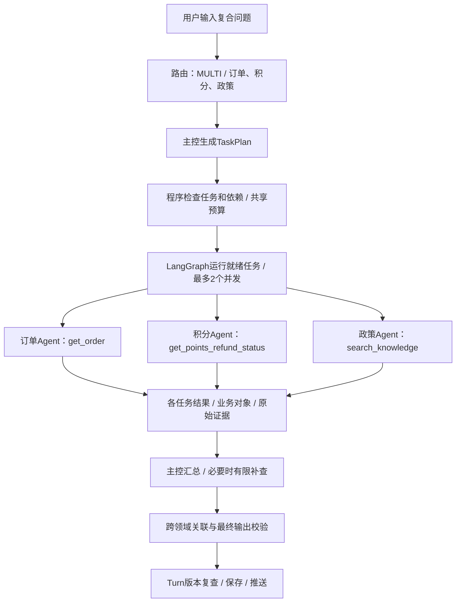
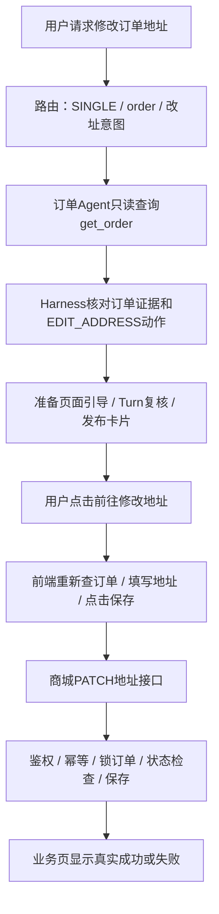

# 多 Agent 三类问题的端到端流程（待审核）

日期：2026-11-01。本文解释拟议的多 Agent 架构，不代表路由、主控和六领域协作已经实现。现有会话服务、业务工具、输出校验、页面动作及改址接口可复用；多 Agent 特有部分待审核后开发。

配套图文审核稿：[架构图与执行流程](多Agent架构图与执行流程_审核稿.md)；浏览器阅读：[离线HTML预览](多Agent架构图与执行流程_预览.html)。

示例数据为讲解假设，不是本次调用接口得到的实时结果。第一例使用企业A年度福利项目的user_002；第二、三例使用同企业同项目的user_001，因为ORDER_A系列演示订单属于user_001。身份和项目始终由登录令牌确定。

## 一、先区分各组件做什么

| 组件 | 模型还是程序 | 工作内容 |
| --- | --- | --- |
| 员工前端 | 程序 | 接收输入、携带令牌、显示消息与操作卡片、提交用户确认的业务操作 |
| 会话服务 | 程序 | 鉴权、会话隔离、保存消息、合并Turn、形成输入快照、最终保存与推送结果 |
| AI Worker | 程序 | 领取Turn及租约、调用AI服务、检查版本、提交或丢弃结果 |
| 路由节点 | 明确规则优先，必要时调用模型 | 判断所需领域和处理模式，不在这里详细规划任务 |
| 主控 Agent | 模型参与，程序约束 | 复合问题拆解、观察结果、有限补充规划与汇总 |
| LangGraph调度 | 程序 | 检查依赖、运行就绪任务、限制并行、合并任务状态；不自行理解用户语义 |
| 领域 Agent | 模型参与，程序约束 | 在自己的工具范围内选择工具、组织参数、读取结果、给出领域结论 |
| ToolExecutor与业务API | 程序 | 真实查询、身份检查、数据返回、工具协议校验、审计和证据记录 |
| Harness | 分布在执行链路中的程序模块 | 上下文、授权、预算、计划/结果/证据/动作校验、有限纠错与超时管理 |

Agent负责提出查询与判断，真实余额、订单状态和规则内容来自工具。LangGraph不会因为节点叫“积分”就自动知道要查什么；具体查询由领域Agent及工具共同完成。

## 二、三种情况共有的前半段

1. 员工登录并选择福利项目。登录令牌携带可信的企业、项目、员工身份。
2. 员工在聊天框输入问题。前端向会话服务发送message_id、消息类型和文本，携带Authorization令牌；不由模型指定查询用户。
3. 会话服务验签并按企业/项目/员工找到会话，检查重复消息，保存用户输入。AI模式下交给Turn管理；人工模式下按人工服务流程投递，不继续启动AI回答。
4. Turn收集当前轮次消息，允许短时间连续输入合并，记录输入版本和消息快照。聊天接口先返回受理结果，不等待全部模型调用结束。
5. AI Worker领取就绪Turn和租约，取得当前输入及受限历史，使用可信身份调用AI Service。
6. AI Service建立根Run，记录输入、执行模式和版本，创建共享预算。上下文编译器准备用户原文、必要历史和业务对象线索；凭据仅放运行上下文。
7. 路由节点根据问题及领域能力目录，输出SINGLE、MULTI、CLARIFY、HANDOFF或普通对话等处理模式。规则不能明确判断时调用模型分类，程序检查分类结构和领域名称。

关键词、句子数量、工具数量都不直接等于领域数量。例如物流Agent可以先查订单再查物流，仍是单领域；商品Agent的兑换预检可以返回余额和资格，不必仅因问题含“积分”就拆给积分Agent。

## 三、例一：简单积分查询

### 用户输入

> 我还有多少年度福利积分？未来30天有多少积分到期？

示例身份：user_002 / tenant_a / welfare_a。



### 分步执行

| 步骤 | 执行者 | 具体行为 |
| --- | --- | --- |
| 意图识别 | 路由节点 | 判断为当前项目积分概况查询，积分Agent已有完整能力，选择单领域路径 |
| 任务准备 | 程序 | 创建一个领域任务用于审计，不调用主控生成复合计划 |
| 加载能力 | 程序 | 固定注入points-service指引与允许工具，不额外调用load_skill |
| 选择工具 | 积分Agent模型 | get_points_account同时返回余额和默认30天临期总量，因此一次查询就足够 |
| 调用工具 | LangChain工具执行与ToolExecutor | runtime注入当前令牌及根Run/任务信息，发起GET /api/v1/points/account |
| 业务查询 | 商城API | 按当前用户和项目查账户，排除已过期批次，计算可用积分和30天临期总量 |
| 返回证据 | ToolExecutor | 验证返回结构，记录成功状态、原始数据、耗时及证据编号 |
| 形成答案 | 积分Agent模型 | 根据结果生成事实引用与候选回复，不自行计算或推测余额 |
| 校验 | Harness | 核对本任务账户、字段、积分值、单位及证据，映射为统一AgentOutput |
| 发布 | AI Worker及会话服务 | 复核Turn版本，保存消息和Outbox，Redis/WebSocket通知前端 |

拟议路由输出的简化形式：

```json
{"route_kind":"SINGLE","domains":["points"]}
```

工具数据假设为：

```json
{
  "account_id":"PA_user_002_welfare_a",
  "available_points":8000,
  "expiring_points":1000,
  "status":"active"
}
```

证据需要分别指向该账户的available_points=8000和expiring_points=1000。最终可回复：

> 您当前年度福利项目可用积分为8000，未来30天有1000积分到期。

只问总额时不必额外查询批次。若追问“具体哪天到期、是哪一批”，仍进入积分Agent，调用get_expiring_points(days=30)。同一个领域调用两个或更多工具，并不会自动升级为复合任务。

单领域路径需要领域Agent生成候选回复；拟议DomainResult可增加candidate_reply用于直接路径，再由公共适配器映射为AgentOutput。复合路径主要读取领域事实和证据，由主控汇总，不机械拼接这些候选回复。

单领域不等于只调用一次模型：可能有分类、工具选择、读结果组织回复等调用。具体次数由审计统计，但无需再增加主控规划和主控汇总。

## 四、例二：订单、积分与政策的复合核查

### 用户输入

> 请核查ORDER_A_003是否已经取消，积分退回来了吗？结合当前项目规则说明，如果退回时原积分已经过期，退回的积分还能用吗？

示例身份：user_001 / tenant_a / welfare_a。订单编号明确，问题同时要求实际订单状态、实际退分状态和条件性规则解释。



### 意图与规划

路由识别为MULTI，选择order、points、policy。主控把用户需求拆为三个可检查的目标：

| 任务 | 领域 | 查询 | 必须回答 |
| --- | --- | --- | --- |
| T1 | 订单 | get_order(order_id="ORDER_A_003") | 订单是否存在于当前授权范围，当前是否取消 |
| T2 | 积分 | get_points_refund_status(order_id="ORDER_A_003") | 退分状态、应退/已退、关联流水及原因 |
| T3 | 政策 | search_knowledge查询当前项目取消退分及原批次有效期规则 | 原批次过期时如何处理，并返回适用来源 |

这里编号和规则问题都明确，三项查询逻辑上独立，可以计划为并行候选；调度器按初始并发上限2运行，第三项等待空闲槽位。三个领域不会直接写同一份可变消息列表。

程序检查目标领域是否存在、任务是否超额、依赖是否有效和无环、任务是否继承同一个授权范围。模型只提出计划，不直接决定无限并行或绕过预算。

### 各领域如何执行

订单Agent调用商城订单API。积分Agent调用退分API，不根据取消状态推断到账。政策Agent通过KnowledgeQueryService查询当前本地政策库，按企业、项目和有效时间筛选；未来替换RAG服务时仍通过该接口。

各工具在真正返回后保存原始结果。示例假设如下：

| 来源 | 假设返回 |
| --- | --- |
| 订单工具 | ORDER_A_003，status=cancelled |
| 退分工具 | 同一订单，status=pending，expected_points=200，returned_points=0，transaction_id=null，原因是待人工核对 |
| 政策工具 | DEMO_CANCEL：沿用原批次期限，退回时原批次已过期部分失效；并说明历史异常订单可能待核对 |

根请求保留原始证据集合，各领域只返回自己查询到的事实、引用和缺失项。政策Agent不把通用规则当作该订单已经完成退分的证明。

### 汇总与校验

主控检查用户要求的三个子问题是否都已回答。若需要实际核对流水，再新增一个受预算约束的积分补查任务，而不是默认把所有积分工具都调用一次。

程序验证订单ID和退分order_id一致，工具证据属于当前根请求及合法任务，200引用expected_points、0引用returned_points，规则编号确实来自本次适用检索。

最终回复示例：

> ORDER_A_003已取消。该订单应退200积分，目前已退0积分，退分仍待人工核对，尚无关联到账流水。当前项目演示规则规定，退回积分沿用原批次期限；如果退回时原批次已经过期，对应部分会记录为失效，不成为可用积分。这里是在说明条件性规则，不能据此认定这笔待处理退分已经发生过期失效。

回复附政策来源和业务事实引用。用户只要求核查，没有要求打开页面，因此不必主动生成交易操作卡片。

### 何时出现串行依赖

如果用户改问“我刚取消的那笔订单积分退了吗”，且历史没有明确对象：先由订单Agent用list_orders确认候选；必要时用get_order读取详情。唯一对象确认后才能给积分任务绑定order_id。若有多个候选，则澄清，不能任选一单。

政策适用若依赖实际商品类别、支付方式或售后类型，也应先取得相应事实再执行针对性检索。不是所有任务都必须并行，也不为展示编排而人为增加无必要的串行查询。

### 失败时怎么办

积分任务失败时，仍可回答已确认的订单状态和政策，但必须说明无法确认实际到账；不能把“查询失败”写成“未到账”。如依赖对象确认失败，停止后续相关任务。投诉、明确要求人工或无法消解的状态冲突，通过统一出口携带摘要转人工。

## 五、例三：请求修改订单地址

### 用户输入

> 我要修改订单ORDER_A_001的收货地址。

示例身份：user_001 / tenant_a / welfare_a。这是订单领域的业务操作诉求，不因涉及修改就必须经过多个Agent。



### AI查询和页面引导阶段

1. 路由识别为订单领域的改址意图，直接进入订单Agent；无需主控复合任务规划。
2. 订单Agent固定加载order-service，调用get_order(order_id="ORDER_A_001")。真实订单查询由商城API校验企业、项目和员工归属。
3. 假设订单为paid或pending_shipment，模型说明用户可到业务页面核对提交，不声称已经修改。若为shipped等不允许状态，则说明当前不能直接改址，不输出成功结论。
4. 订单Agent提出page_action_request，包含EDIT_ADDRESS及订单编号；模型不自由生成外部链接，也不调用PATCH接口。
5. Harness确认动作在白名单，并确认本根请求中有成功get_order证据支持该订单，程序生成固定路径。

模型动作请求示例：

```json
{
  "action_code":"EDIT_ADDRESS",
  "resource_id":"ORDER_A_001"
}
```

程序生成的用户消息动作示例：

```json
{
  "label":"前往修改地址",
  "description":"进入订单页面修改收货地址",
  "href":"/me/orders/ORDER_A_001/address"
}
```

用户看到的内容类似：

> 该订单当前尚未发货。请进入修改地址页面，核对并保存新的收货地址。
>
> [前往修改地址]

生成卡片不等于修改成功。沿用当前协议，带页面动作的根Run进入DECISION_PREPARED，AI Worker复核输入版本，再确认该根结果可发布。这个confirm只是确认发布AI结果，不是确认订单交易；子任务不单独confirm。

### 用户确认与真实写入阶段

1. 用户点击卡片，前端跳到地址页面，重新从商城API读取订单最新状态及当前地址。
2. 用户在表单填写或修改地址，点击“保存地址”。当前实现以该表单提交作为操作确认，不需要再假设一个尚未实现的二次弹窗。
3. 前端携带当前令牌和Idempotency-Key调用业务接口：

```http
PATCH /api/v1/orders/ORDER_A_001/address
Authorization: Bearer <当前员工令牌>
Idempotency-Key: <本次操作键>
Content-Type: application/json

{"address":"上海市虹口区演示路88号"}
```

4. 商城后端校验身份、项目、订单归属、地址字段和幂等键，锁定订单并重新检查状态；只有paid或pending_shipment才允许修改。
5. 允许时保存地址、增加订单版本并提交事务；重复相同幂等请求返回已保存结果。状态已变为shipped时返回冲突，不执行修改。
6. 前端以业务API返回为准显示“收货地址已更新”或失败原因，成功后返回订单详情。

当前动作协议只携带label、description、href，没有把聊天文本中的新地址自动回填到表单。如果用户在聊天里提供新地址，仍需到页面核对填写；若要自动预填，需要另行评审协议与前端实现。

实际保存不会自动改写原聊天消息，也没有现成的“业务保存后Agent自动再发一条成功回复”链路。本阶段由业务页面展示成功，用户后续询问时Agent重新查询订单。

## 六、公共校验与发布出口

| 时机 | 检查内容 |
| --- | --- |
| 路由/规划后 | 分类和计划结构、领域白名单、依赖、数量与预算 |
| 工具调用前 | 领域授权与共享预算；参数结构和业务权限分别由工具Schema及商城API校验 |
| 工具返回后 | 返回协议、成功/失败、原始证据与任务归属 |
| 领域结果后 | 字段、对象、证据、缺失项、候选回复或动作建议是否合法 |
| 最终回答后 | 事实引用、政策引用、跨领域关系与页面动作 |
| 会话保存前 | Turn输入版本仍有效，根结果未过期，仅根请求允许发布 |

现有字段和数字校验不能保证所有自然语言语义完全正确。多Agent新增关系检查后，仍要通过标注用例验证回答忠实度，不能只统计Schema通过率。

没有页面动作的普通回答，可沿用当前完成结果再进入最终版本复查；带动作的结果沿用准备/确认协议。会话服务在保存消息和Outbox前仍会复核输入版本，避免用户追加消息后旧答案继续发布。

Outbox与消息在同一数据库事务中保存；实时Worker读取事件后发布到当前企业/项目对应的Redis频道，由WebSocket送达前端。当前阶段不需要把每个子Agent的中间文本直接发给员工，任务细节主要在后台审计中查看。

## 七、三个例子的区别

| 内容 | 简单积分查询 | 跨领域核查 | 修改地址 |
| --- | --- | --- | --- |
| 路由 | SINGLE / 积分 | MULTI / 订单、积分、政策 | SINGLE / 订单 |
| 主控完整规划/汇总 | 不需要 | 需要 | 不需要 |
| 领域工具 | 账户查询，明细按需追加 | 订单、退分、规则，按条件补查 | 只读订单查询 |
| LangGraph主要职责 | 单领域节点和公共出口 | 任务依赖、受控并行、结果反馈 | 单领域节点和公共出口 |
| Agent是否写交易数据 | 否 | 否 | 否 |
| 页面动作 | 通常无 | 本例只核查，通常无 | EDIT_ADDRESS卡片 |
| 真实业务写入 | 无 | 无 | 用户表单提交后由商城API执行 |
| 用户最终看到 | 实时余额与临期总额 | 状态、退分事实和规则来源 | 操作说明/卡片，然后由业务页展示保存结果 |

三个流程均计入根请求的全链路耗时与Token。路由、领域工具选择、主控规划、汇总、纠错是否调用模型，以及调用几次，应由真实运行轨迹统计，不能从Agent数量直接推算。
