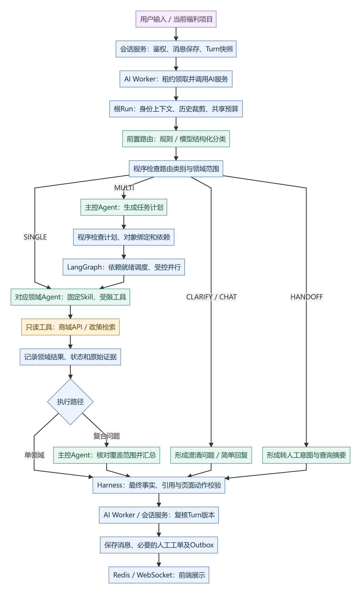
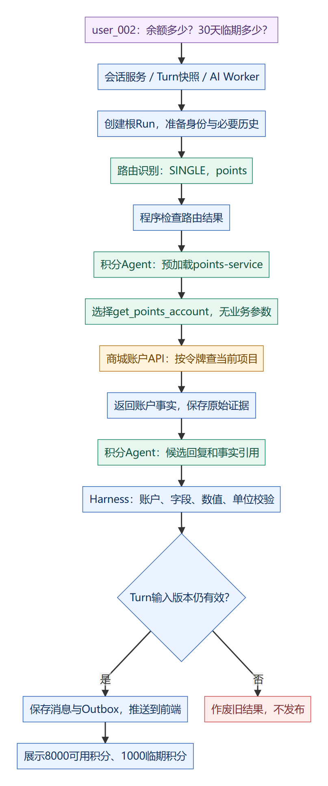
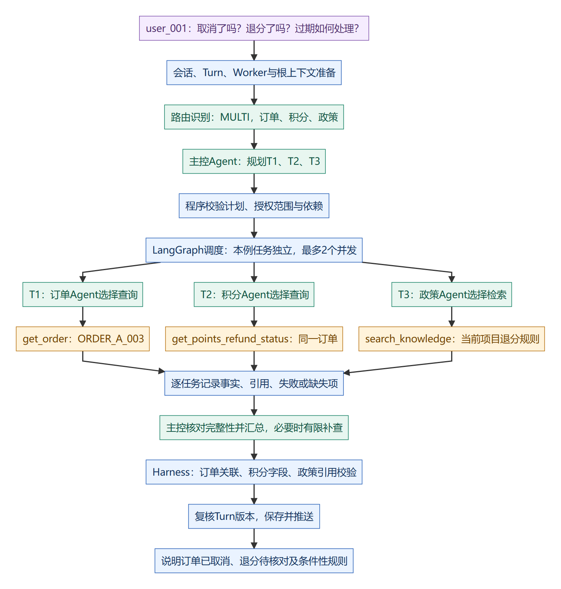
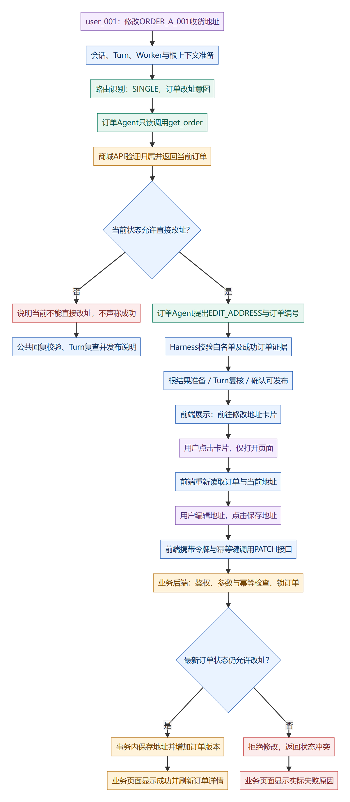

# 多 Agent 架构图与执行流程（审核稿）

日期：2026-11-01。版本：评审稿 v1。

本稿用于确认实施方案。前置路由、主控、六领域协作及共享任务预算尚未开发；会话Turn、业务工具、部分Harness校验、页面动作和商城写接口已有基础。本次不实施业务代码改造。

图中示例数字只用于讲解，不是本次实时查询结果。第一例使用企业A年度福利项目的user_002；第二、三例使用user_001，因为ORDER_A系列演示订单属于user_001。

## 1. 阅读方法与组件职责

图中蓝色表示程序流程或校验，绿色表示有模型参与的决策，橙色表示实际业务查询/处理，紫色表示用户或人工操作。颜色辅助阅读，具体职责以节点文字和下表为准。

| 组件 | 谁执行 | 负责内容 |
| --- | --- | --- |
| 会话服务 | 程序 | 鉴权、保存消息、会话范围、Turn消息合并与输入版本 |
| AI Worker | 程序 | 租约领取、调用AI、结果版本复查、保存与发布协作 |
| 上下文构建 | 程序 | 从会话请求整理必要历史、当前问题和对象线索；凭据不交给模型生成 |
| 前置路由 | 规则或一次受约束模型分类 | 识别SINGLE、MULTI、CLARIFY、HANDOFF、CHAT及所需领域 |
| 主控Agent | 模型参与、程序约束 | 仅在复合路径做任务规划、有限补查与汇总 |
| LangGraph调度 | 程序 | 检查依赖、运行就绪任务、限制并发，记录状态 |
| 六领域Agent | 模型参与、程序约束 | 固定加载所属Skill，在授权工具范围内查询并形成领域结果 |
| 工具与业务API | 程序 | 实际读取业务数据、检查身份、返回结果、写调用审计 |
| Harness | 分布式执行控制代码 | 上下文、授权、总预算、计划/结果/证据/动作校验、有限纠错与超时 |

路由不是主控：前者选择处理路径，后者规划复合任务。路由分类模型可以复用同一个模型适配层，不另部署一套模型，也不算第八个领域Agent。

Skill是领域指引与工具配置，不是独立Agent；固定加载是由程序将其指引注入Prompt，不额外执行load_skill。单Agent基线继续使用动态Skill加载。

## 2. 整体架构图

[可缩放SVG](diagrams/multi-agent-review/00-overview.svg) · [可编辑Mermaid源码](diagrams/multi-agent-review/00-overview.mmd)

### 公共入口

1. 员工登录并选择福利项目，令牌提供可信企业、项目、员工身份。
2. 前端发送message_id、消息类型、文本及令牌，接口先受理，不同步等待整个模型流程。
3. 会话服务鉴权、去重并保存消息。处于人工模式的会话直接进入人工链路；AI模式下收集Turn及输入版本。
4. AI Worker领取Turn，读取本轮及历史消息并组装请求。现有实现由TurnService.build_ai_request_data读取数据库消息，由AI侧ContextCompiler裁剪和规范化；多Agent改造会在路由前复用并扩展此能力。
5. AI服务建立根Run，准备共享预算与可信运行上下文。历史订单编号只是对象线索，业务实时状态仍需重新查询。
6. 路由根据完整问题、必要历史、对象线索及能力目录分类。程序检查枚举、领域范围和分类一致性，不把格式正确等同于语义理解一定正确。

### 分类与后续路径

| 路由类型 | 后续流程 |
| --- | --- |
| SINGLE | 直接调用具备完整处理能力的领域Agent，不经过主控完整规划与汇总 |
| MULTI | 主控生成TaskPlan，程序校验后由LangGraph执行，最后主控汇总 |
| CLARIFY | 形成具体澄清问题，经公共校验和版本复查后发送 |
| HANDOFF | 形成转人工意图与摘要，服务端创建/复用工单，先进入QUEUED，客服接单后才进入HUMAN |
| CHAT | 简单问候等直接回复，无需业务查询 |

没有订单编号不一定立刻澄清：可先查候选订单；多个候选仍无法确定或意图本身不明确时再询问。

### Agent、Skill与工具

| Agent | Skill | 查询工具 |
| --- | --- | --- |
| 主控 | 固定规划与汇总指引 | 本方案通过任务计划和图节点委派，不直接配置商城工具 |
| 商品 | product-service | search_products、get_product、get_product_stock、quote_redemption |
| 订单 | order-service | list_orders、get_order |
| 物流 | logistics-service | list_orders、get_order、get_logistics |
| 售后 | aftersales-service | get_order、list_after_sales |
| 政策 | policy-service | search_knowledge |
| 积分 | points-service | get_points_account、list_points_transactions、get_expiring_points、get_points_refund_status、quote_redemption |

现有目录保持13个去重查询工具加load_skill，共14项。共享工具不重复计数；复合计划明确一次查询的任务归属。所有Agent继续只读交易数据。

## 3. 场景一：简单积分查询

> 用户：我还有多少年度福利积分？未来30天有多少积分到期？

[可缩放SVG](diagrams/multi-agent-review/01-points-query.svg) · [可编辑Mermaid源码](diagrams/multi-agent-review/01-points-query.mmd)

| 步骤 | 谁处理 | 执行说明 |
| --- | --- | --- |
| 1 | 公共入口 | 按user_002、tenant_a、welfare_a受理消息、创建Turn、读取必要历史和建立根Run |
| 2 | 路由 | 识别为积分概况，返回SINGLE和points；一个领域已有完整能力 |
| 3 | 程序 | 校验路由，创建一个领域任务，固定加载points-service及积分工具 |
| 4 | 积分Agent | 选择get_points_account；余额与30天临期总量都在同一结果中，无需多查一次 |
| 5 | 工具与商城API | 携带当前运行令牌调用GET /api/v1/points/account；按员工和项目查账户，排除已过期批次 |
| 6 | 工具执行器 | 校验返回协议，保存原始结果、成功状态、耗时和证据编号 |
| 7 | 积分Agent | 假设返回available_points=8000、expiring_points=1000，生成候选回复及对应事实引用 |
| 8 | Harness | 核对账户、工具证据、字段、数值和单位，将领域候选回复映射为统一AgentOutput |
| 9 | Worker和会话服务 | 复核Turn输入版本；有效才保存消息与Outbox，实时推送；过期则作废 |

用户看到：

> 您当前年度福利项目可用积分为8000，未来30天有1000积分到期。

本例不需要主控计划，不调用全部积分工具，不产生交易写入。若用户追问具体哪天到期，再由积分Agent调用get_expiring_points(days=30)，仍属于单领域。

## 4. 场景二：跨订单、积分和政策核查

> 用户：请核查ORDER_A_003是否已经取消，积分退回来了吗？结合当前项目规则说明，如果退回时原积分已经过期，退回的积分还能用吗？

[可缩放SVG](diagrams/multi-agent-review/02-cross-domain.svg) · [可编辑Mermaid源码](diagrams/multi-agent-review/02-cross-domain.mmd)

### 识别与规划

公共入口使用user_001的当前项目身份。路由识别为MULTI，所需领域为order、points、policy。主控提出三个任务：

| 任务 | 领域和工具 | 要取得的结果 |
| --- | --- | --- |
| T1 | 订单Agent：get_order(order_id="ORDER_A_003") | 授权范围内的订单及实际状态 |
| T2 | 积分Agent：get_points_refund_status(order_id="ORDER_A_003") | 同一订单的退分状态、应退/已退、关联流水和原因 |
| T3 | 政策Agent：search_knowledge | 当前项目取消退分、原批次期限和过期处理规则及来源 |

本例编号和规则条件明确，查询逻辑独立，可作为并行候选。程序校验计划、领域、依赖、对象和预算，LangGraph按初始最多2个任务并发运行，剩余任务等待槽位。LangGraph执行计划，不自行理解用户语义。

### 领域执行与结果汇总

1. 三个领域各自使用独立消息上下文和工具范围，查询后返回结构化DomainResult，不直接对员工发消息。
2. 工具结果假设为：订单cancelled；退分pending、应退200、已退0、无到账流水、待人工核对；政策规定沿用原期限，退回时过期部分失效。
3. 根请求保留各任务的原始工具证据。主控核对三个子问题是否都已回答，分开说明实际状态和条件性规则。
4. 如确实缺少流水核查，可在共享预算内补充一次积分任务；不会默认调用所有工具。
5. Harness核对订单ID与退分order_id一致、引用属于合法任务，200引用应退字段、0引用已退字段，规则编号来自本次适用检索。
6. 最终回复经Turn版本复查后保存和推送。只核查信息时通常不主动生成交易卡片。

用户看到的示例：

> ORDER_A_003已取消。该订单应退200积分，目前已退0积分，退分仍待人工核对，尚无关联到账流水。按当前项目演示规则，退回积分沿用原批次期限；如果退回时原批次已经过期，对应部分会失效，不成为可用积分。

“如果过期”是条件性规则，不代表这笔尚未处理的退分已经发生失效。

### 串行依赖与异常

若问题改成“刚取消的那笔订单积分退了吗”，历史没有对象，则先由订单Agent查询候选；唯一订单确认后才执行绑定该编号的积分任务。多个候选时先澄清。若政策适用依赖商品类别或售后类型，也要先取得对应事实。

积分查询失败时，可以回答已确认的订单状态和政策，但必须说明无法确认到账，不能把失败当成“尚未退回”。明确投诉、请求人工或无法消解的冲突，由根请求携带摘要进入人工流程。

## 5. 场景三：请求修改订单地址

> 用户：我要修改订单ORDER_A_001的收货地址。

[可缩放SVG](diagrams/multi-agent-review/03-edit-address.svg) · [可编辑Mermaid源码](diagrams/multi-agent-review/03-edit-address.mmd)

### A. AI查询与操作引导

1. 公共入口使用user_001身份，路由识别SINGLE、order和改址意图。涉及写操作不等于需要多个领域Agent。
2. 订单Agent固定加载order-service，只读调用get_order(order_id="ORDER_A_001")。
3. 商城API鉴权并返回订单。若已支付或待发货，可说明用户能去页面核对提交；若已发货等不允许状态，则说明不能直接改址，不声称成功。
4. 模型提出EDIT_ADDRESS和订单编号，不调用PATCH，不自由生成执行地址。
5. Harness校验动作白名单及本次成功订单证据，由服务端生成/me/orders/ORDER_A_001/address。
6. 沿用现有准备结果协议：根结果进入DECISION_PREPARED，Worker复核输入版本，确认结果可发布，最终保存和推送操作卡片。

用户看到：

> 该订单当前尚未发货。请进入修改地址页面，核对并保存新的收货地址。
>
> ［前往修改地址］

此时没有修改地址。Run的confirm只是确认发布AI结果，不是员工确认交易写入。

### B. 用户确认与真实业务写入

1. 用户点击卡片，前端只跳转页面，并重新查询订单最新状态和当前地址。
2. 用户编辑表单并点击“保存地址”。当前表单提交就是操作确认，不额外假设二次弹窗。
3. 前端携带Authorization和Idempotency-Key调用PATCH /api/v1/orders/ORDER_A_001/address，提交address字段。
4. 商城后端检查身份、项目、订单归属、字段及幂等键，锁定订单并重新检查状态。只有paid或pending_shipment允许修改。
5. 符合条件则在事务中保存地址、增加订单版本并提交；同一幂等键和相同参数返回已保存结果。
6. 如果用户提交前订单已经发货，则返回状态冲突，不能因为AI此前查询允许就直接写入。
7. 前端根据业务接口实际结果显示“收货地址已更新”或失败原因，成功后刷新订单详情。

当前动作协议不自动把聊天中给出的新地址回填表单，也没有业务保存后自动追加AI成功消息的链路。第一阶段由用户在页面核对填写，由业务页展示真实结果；若需要预填和自动通知，再单独扩展协议。

## 6. 校验、失败与发布的共同规则

| 位置 | 检查什么 | 不通过时 |
| --- | --- | --- |
| 路由后 | 分类结构、领域范围、SINGLE/MULTI一致性 | 有限纠错、升级主控或澄清，服务不可用时降级 |
| 主控规划后 | 任务数量、依赖无环、对象绑定、授权边界和预算 | 修正计划或停止对应任务 |
| 工具调用前后 | Agent范围、调用预算、参数/权限、返回结构和原始证据 | 记录失败，必要时局部重试 |
| 领域结果后 | 任务状态、事实和引用、缺失条件 | 补查、保留可靠部分或澄清 |
| 最终输出后 | 实体关系、字段值、政策来源、页面动作白名单 | 有限纠错或降级，不发布未经确认的事实 |
| 会话保存前 | 当前输入版本是否仍匹配Turn快照 | 作废旧结果，不能覆盖新输入 |
| 业务写入前 | 商城权限、最新状态、参数、锁和事务幂等 | 返回实际业务错误，不能用AI结论绕过 |

字段和引用校验不等于完整证明自然语言语义正确，仍需标注用例和Bad Case回归。取消本地模型等待也不保证供应商已停止生成或不计费。

消息与Outbox事务保存，实时Worker经Redis频道和WebSocket投递。子Agent中间文本主要用于后台审计，普通用户收到的是根请求统一结果。HANDOFF先排队，客服接单后才真正进入人工会话。

## 7. 审核确认的设计点

- 前置路由独立于主控；对普通自然语言主要使用受约束分类模型，明确规则可跳过模型分类。
- 单领域直接调用一个领域Agent；复杂任务才走主控规划、图调度和汇总。
- 六领域固定加载所属Skill，工具执行层保留领域授权；单Agent基线保留动态Skill。
- 任务结果必须保留对象、原始工具证据、政策引用和缺失项，不能只传一段自然语言。
- 有依赖才串行，独立任务在共享预算下受控并行。
- 所有Agent保持交易只读；页面卡片只是导航，用户保存后业务API才写入。
- 普通回复与操作卡片均经根请求校验和Turn复查，只由统一出口发布。
- 保留single/multi两种运行方式，后续使用固定用例对比效果、耗时与全链路Token。

原始长文：[三类场景端到端说明](多Agent三类问题端到端流程_待审核.md)。代码与范围清单：[多智能体改造方案](多智能体架构改造方案_待审核.md)。
