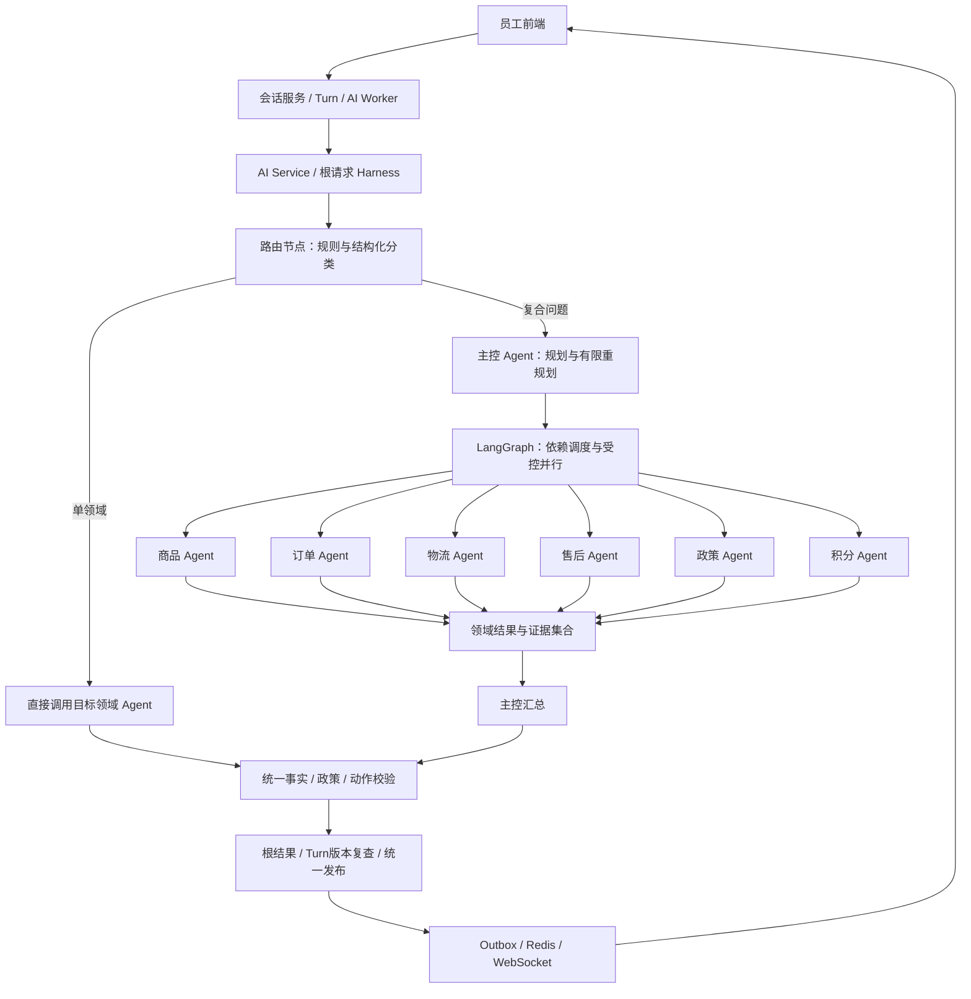

# 企享积分福利平台：多智能体服务协同升级方案（待审核）

方案日期：2026-11-01；2026-11-02审核通过并实施初版。本文保留审核时的设计记录；实际配置、代码与验收说明见[多Agent实现与运行验收.md](多Agent实现与运行验收.md)。

图文审核入口：[整体架构图与三个场景流程](多Agent架构图与执行流程_审核稿.md)；[离线HTML预览](多Agent架构图与执行流程_预览.html)。文中图片已静态导出，不依赖Markdown编辑器的Mermaid插件。

依据：用户提供的简历第2—3页“企享积分福利平台-多智能体服务协同升级项目”，以及当前项目源码。本文中的新增模块、配置和执行协议均为拟议设计，不代表当前代码已经实现。

## 1. 方案结论与范围

按简历采用“1个主控 Agent + 6个领域 Agent”，六个领域分别为商品、订单、物流、售后、政策、积分。保留六类 Skill 和现有工具目录，使用 LangGraph 编排单领域直接路由、复合任务规划、依赖执行、受控并行及统一结果校验。

与前次讨论的四领域合并方案相比，本次明确按简历拆为六领域。单领域请求不经过主控的完整规划与汇总循环，以控制额外开销；六个领域 Agent 不会每次全部启动。

三个端到端例子见[多Agent三类问题端到端流程_待审核.md](多Agent三类问题端到端流程_待审核.md)，分别说明积分查询、跨领域退分核查与修改订单地址，包含模型决策、程序调度、校验和发布的分工。

本次拟改造的是 AI 调度、上下文、协作协议、证据链、Harness、审计和评测。继续复用商城交易 API、项目独立积分账户、会话 Turn、Outbox、Redis/WebSocket 和人工接管。

本阶段不建设完整向量 RAG，不执行模型微调，不引入自主交易写工具，不扩展混合支付、部分退款、虚拟卡券或供应商对接。

## 2. 简历条目与实现对照

| 简历内容 | 当前基础 | 本次拟实现 |
| --- | --- | --- |
| 主控与六类领域 Agent | 单 Agent，六类动态 Skill | 独立角色、上下文、工具范围和领域执行循环 |
| 单领域直接路由 | 单 Agent 自行选择 Skill | 路由节点直接调用一个领域 Agent，绕过主控规划与汇总 |
| 主控拆解、串行依赖、受控并行 | 单 Agent 顺序切换 Skill | 结构化任务计划、依赖图、就绪任务调度、结果反馈与有限重规划 |
| 复用 Skill 与工具目录 | 六类 Skill、十四个已注册工具 | 保留目录，增加 Agent 级授权范围，默认固定加载所属 Skill |
| 结构化协作协议 | 面向用户的 AgentOutput | 新增领域任务和 DomainResult，区分任务结果与用户回复 |
| 请求总预算、超时、部分失败 | 单 Agent 局部预算与执行超时 | 根请求共享预算、子任务上限、取消传播、局部恢复与降级 |
| 跨领域证据关联 | 单 Run 工具证据、政策引用及页面动作校验 | 根 Run—领域任务—工具证据关联及最终汇总复核 |
| 根 Run、领域任务、工具调用分层审计 | Run 和工具调用审计 | 领域任务审计、执行图、模式对比与成本统计 |
| 独立测试集与单 Agent 对照 | 接口/领域回归及真实模型烟测 | 固定模型和业务快照的路由、复合任务、忠实度及成本评测 |

简历中的85%复合任务成功率、75%自动解决率属于待数据核实的量化条目。现有测试不能证明这两个结果；实现后应报告实际评测值，不预填达到目标。

## 3. 整体架构

六个领域 Agent 都通过现有只读工具访问商城或知识服务。可信运行上下文提供企业、福利项目和员工身份；任务计划、模型参数和子 Agent 输出均不能改变授权范围。

逻辑 Agent 与部署服务不一一对应。本阶段六个领域 Agent 与主控运行在同一个 AI Service 中，不新增六个微服务或六套业务数据库。

LangGraph 负责状态、条件分支和任务调度；LangChain 负责各领域 Agent 的模型/工具执行；自定义 Harness 负责预算、证据、权限边界、输出校验与审计。

## 4. Agent 职责与边界

| 组件 | 职责 | 边界 |
| --- | --- | --- |
| 主控 Agent | 复合问题拆解、领域选择、识别依赖、查看任务结果、补充查询、汇总、提出澄清或人工接管 | 不直接操作商城，不绕过子任务证据编写业务事实 |
| 商品 Agent | 商品搜索、规格、项目积分价、库存、兑换预检、兑换页面意图 | 不创建订单、不锁库存、不扣积分 |
| 订单 Agent | 订单列表、对象确认、状态、积分消费、取消/改址页面意图 | 不直接取消或修改订单，不以订单取消推断退分完成 |
| 物流 Agent | 订单发货、承运方、运单、轨迹 | 无物流时说明未取得信息，不编造到货承诺 |
| 售后 Agent | 查询退款/退货/换货申请、实际处理状态、售后页面意图 | 不把受理或批准当作积分到账；规则解释交政策领域 |
| 政策 Agent | 检索本项目有效规则、返回条款及来源、区分公开参考 | 不判断实时余额、到账或商品库存，不把外部制度当当前企业承诺 |
| 积分 Agent | 账户、流水、临期、订单退分、兑换资格预检 | 不发分、延期、扣分、退分，不跨福利项目合并账户 |

路由节点、校验器、调度器和人工客服不是额外的领域 Agent。六个领域 Agent 不相互委派、不直接向用户发布消息，所需其他领域信息通过主控与调度器协调。

每个领域 Agent 应具有独立提示词、独立消息上下文、受限工具集合和实际多步查询能力；仅把一段提示词或一个函数换名，不作为多 Agent 实现成果。

## 5. Skill 与完整工具分配

六类 Skill 继续保留。多 Agent 模式默认由程序固定加载所属 Skill，不要求每次先调用 load_skill。现有动态 Skill 加载继续用于单 Agent 基线，领域内将来出现多个子技能时再启用受限动态加载。

| 领域 Agent | Skill | 允许的查询工具 |
| --- | --- | --- |
| 商品 | product-service | search_products、get_product、get_product_stock、quote_redemption |
| 订单 | order-service | list_orders、get_order |
| 物流 | logistics-service | list_orders、get_order、get_logistics |
| 售后 | aftersales-service | get_order、list_after_sales |
| 政策 | policy-service | search_knowledge |
| 积分 | points-service | get_points_account、list_points_transactions、get_expiring_points、get_points_refund_status、quote_redemption |

去重后是13个查询工具，加现有 load_skill 共14个目录项。复用工具不重复计数。比如物流 Agent 使用 get_order，不会额外增加一个“物流订单查询工具”。

| 工具 | 用途 |
| --- | --- |
| search_products | 当前项目商品搜索，空关键词可列项目商品 |
| get_product | 商品基础信息、积分价和个人限额 |
| get_product_stock | 当前商品库存及状态 |
| list_orders | 当前员工和项目订单列表、对象确认 |
| get_order | 具体订单事实、版本及页面动作依据 |
| get_logistics | 承运商、运单及物流轨迹 |
| list_after_sales | 实际售后申请与处理状态 |
| search_knowledge | 本项目规则或明确指定单位的公开参考检索 |
| get_points_account | 可用余额、账面余额、临期概况与账户版本 |
| list_points_transactions | 当前账户最近30条流水，可按订单筛选 |
| get_expiring_points | 指定未来时间范围内的到期批次与总量 |
| get_points_refund_status | 应退、已退、退回时失效和可用部分及关联流水 |
| quote_redemption | 后端校验余额、库存、状态、数量及个人兑换限额 |
| load_skill | 加载领域指引，主要保留给单 Agent 基线 |

quote_redemption 保持现有商品和积分领域可复用设计。复合计划中明确由一个任务负责预检，其余任务复用经校验的结果，避免无意义的重复查询。预检是查询，不锁库存、不扣积分，正式兑换仍在业务后端重新校验。

本方案选择由主控生成结构化计划、LangGraph 节点执行领域委派，不额外注册六个 delegate 工具。因此不能把“六个领域调度节点”计为六个新增商城工具。若后续改为“子 Agent 即工具”的实现，应作为编排方式替换单独评审。

工具授权应由代码实现：实际工具集合 = Agent授权集合 ∩ 当前Skill集合；Skill切换也必须受 Agent 允许列表限制。只向模型隐藏工具不能替代执行时的范围校验。

## 6. 路由、规划与领域上下文

### 6.1 单领域快速路径

例如“我的积分还有多少”“订单ORDER_A_002到哪里了”：路由节点识别目标领域后，直接调用积分或物流 Agent。领域 Agent 完成多步查询并生成候选回复，经过公共校验和根请求发布出口返回。无需主控再生成一次回答。

路由输出拟包含 route_kind、domain、识别出的对象提示及需要澄清的信息。先使用明确对象消息、当前追问上下文等规则；无法判断时使用受结构约束的模型分类。模型自报置信度不单独作为放行依据。

路由节点不是第八个 Agent，也不因问候、明显转人工或信息不足而强行进入六个领域。误路由时允许一次升级为主控处理，仍需受全局预算限制。

### 6.2 复合问题路径

主控输出 TaskPlan，包含子问题、目标领域、任务ID、依赖、对象绑定及预期结果。程序校验领域白名单、任务数量、依赖存在性、无环、对象引用和输入范围，然后调度当前依赖已满足的任务。

子任务不直接接收整份共享可变会话状态。上下文由程序构建，包含用户原文、任务目标、必要历史、已确认对象和允许使用的上游证据。保留否定条件、项目范围和待澄清信息；身份令牌仅进入运行上下文，不进入模型提示词或可持久化图状态。

### 6.3 依赖与并行示例

“刚取消的耳机订单，积分退回来了吗，过期部分还能用吗？”没有明确订单编号时：

1. 订单 Agent 查询候选订单；多个候选且无法确定时，返回澄清，不自动任选一单。
2. 编号确认后，积分 Agent 查询该订单退分状态，政策 Agent 查询当前项目规则；二者可并行。
3. 如需判断实际售后处理，按计划补充售后 Agent；并非每次退分问题都调用全部领域。
4. 主控分开说明订单取消、退分业务状态、原批次失效和当前可用余额，提供对应证据。
5. 对投诉或退分争议生成携带查询摘要的转人工意图。

“哪些积分快过期，我能用它们换耳机吗？”：积分批次查询与已明确商品的商品查询可并行；兑换预检必须在商品对象确定后执行。不能因为最早到期批次不足，就直接推断整单无法兑换，也不能由模型自行重新实现业务资格计算。

## 7. 结构化协作协议

拟新增三个协议，和面向用户的 AgentOutput 分开：

| 协议 | 核心字段 |
| --- | --- |
| TaskPlan | plan_version、tasks、task_id、domain、goal、depends_on、entity_bindings、expected_outputs |
| DomainTask | root_run_id、task_id、parent_task_id、domain、attempt、状态、截止时间、已授权上下文引用 |
| DomainResult | task_id、domain、result_status、entities、business_facts、knowledge_references、evidence_ids、missing_information、error、action_suggestions、observed_at、candidate_reply（单领域直达路径的可选候选回复） |

领域结果状态拟分为 SUCCESS、PARTIAL、NEEDS_CLARIFICATION、FAILED。执行审计另记录待执行、运行、超时、取消等过程状态；业务订单和退分状态保留在事实字段中，不混用。

证据编号由工具执行器服务端生成并关联原始调用，不由子 Agent 编造。主控只允许引用本根请求授权证据集合内的数据。最终用户回复仍转换为现有 ANSWER、CLARIFY、DECLINE、REQUEST_HANDOFF 及页面动作协议。

子 Agent 可以提出页面动作或转人工建议，不能直接发布消息、创建人工工单或执行交易。由根请求聚合后走统一出口。

## 8. Harness 扩展

| 能力 | 改造内容 |
| --- | --- |
| 身份与范围 | 企业/项目/员工身份从签名令牌注入，所有子任务继承，模型不可修改 |
| 上下文 | 根上下文与领域上下文分离，上游结果按任务需要传递 |
| 执行边界 | Agent工具授权与Skill范围双重限制，领域之间不得绕过调度互调 |
| 总预算 | 根请求统一计算耗时、委派、业务查询、模型调用及Token消耗 |
| 受控并行 | 只调度依赖就绪任务，使用共享并发限制，结果按任务ID合并 |
| 结构与证据 | 校验子任务协议和最终用户回复，保留原始工具结果 |
| 跨领域关联 | 关联订单、售后单、账户、积分流水、批次及适用政策版本 |
| 恢复与降级 | 区分业务拒绝、信息不足、服务失败；局部重试、澄清、部分回答或转人工 |
| 版本与发布 | 保留Turn输入版本检查与过时结果作废，只有根请求能形成对外结果 |
| 审计 | 根Run、领域任务、工具调用分层记录，汇总Token与耗时 |

建议初始配置如下，仅作为可调整的试运行参数，不是实测容量或性能结论：

| 配置 | 初始建议 |
| --- | --- |
| 根请求执行时限 | 120秒，沿用当前生成执行预算 |
| 单领域任务时限 | 45秒，并受根请求剩余时间约束 |
| 根请求领域任务执行次数 | 最多8次，重试及补充委派均计入 |
| 根请求查询工具尝试次数 | 最多24次，业务与知识查询、失败及重试均计入 |
| 单领域任务查询工具次数 | 最多6次，并受根预算约束 |
| 同时运行领域任务 | 最多2个，服务侧另设进程级并发限制 |
| 主控补充规划 | 最多1次 |
| 根请求模型调用次数 | 最多24次，路由、规划、工具循环、汇总和纠错全部计入 |
| 根请求Token预算 | 初始建议30000，发起前预留、调用后结算，按实际评测调整 |

共享预算应通过程序原子检查和预留，不能只依赖 Prompt。预算、图步数和取消状态共同阻止无限规划或不断重试。

知识库规则仍由生效日期、企业和项目元数据决定。公开参考不覆盖当前模拟企业规则；政策解释不能代替余额或到账事实。必要时补齐退分工具DTO的账户/退分单标识及知识元数据，增强可审计的关联校验。

工具返回的状态和余额是带查询时间的快照。冲突时核对实体、版本和时间，按预算重新查询；不能随意选择某个 Agent 的结论，也不能把两个不同时点的余额拼成一张一致快照。

## 9. 异常、人工与交易写入

| 情况 | 处理策略 |
| --- | --- |
| 缺订单/商品条件或对象不唯一 | 根请求提出澄清，保留已确认范围 |
| 业务接口返回无权限或项目不含商品 | 明确解释授权范围，不跨企业/项目尝试查询 |
| 某个独立子任务失败 | 返回已有可靠部分并说明未确认项，不推断缺失事实 |
| 后续任务依赖失败任务 | 标记依赖阻塞，不用空值或其他用户对象继续执行 |
| 短暂服务失败 | 在共享预算内局部重试，不重跑所有成功任务 |
| 根请求超时、过期或被取消 | 停止后续调度，取消在途调用，已结束根请求不得被迟到子任务覆盖 |
| 投诉、交易争议、无法消解的状态冲突 | 携带对象、已查事实、失败项和引用摘要转人工 |

兑换、取消、改址、售后申请仍由员工业务页面确认，退分仍由业务接口自动处理正常取消或由工作人员核对。所有 Agent 均不直接发放、延期、扣减或退回积分。

现有Run确认用于发布准备结果，不等于员工交易确认。客服服务在消息、人工工单和Outbox写入前复核Turn快照；多Agent任务只产生内部结果，不独立走confirm或发送聊天消息。

当前Worker在AI调用返回后复核输入版本，现有cancel接口主要处理已准备结果；它尚不能在用户追加输入时立即停止运行中的AI请求。多Agent改造需补充受鉴权约束的Turn有效性检查或取消通知，让调度检查点能发现过期并向子任务传播取消。最终发布前的快照复查仍为兜底；取消本地等待不保证模型供应商已经停止生成，也不保证不计费。

先复用现有Turn租约及失败重试：进程中断后可重新执行根请求的只读查询。第一阶段不承诺任意LangGraph节点的持久化断点续跑；后续若增加checkpoint，应另行设计幂等审计、取消状态及恢复语义，不能简单把会话ID当作全局共享thread_id。

## 10. 分层审计与管理界面

建议保留AgentRun作为一轮请求的根记录，新增AgentTask表，给AgentToolCall增加可空task_id，历史单Agent调用保持可读。

根Run新增或补充执行模式、路由结果、计划版本、图版本、共享预算使用量。领域任务记录Agent名称、Skill/Prompt版本、依赖、尝试次数、任务输入输出、错误、Token和耗时。工具记录关联根Run及任务，区分业务证据ID和模型原始tool_call_id，避免不同子Agent编号冲突。

最终校验器按授权根Run收集参与本次回答的任务证据，而不是只读取主控自己的工具，也不是读取整段会话所有历史工具。失败、取消、被替代结果不能因仍在数据库中而自动成为有效证据。

后台新增执行模式筛选、路由结果、任务依赖和状态、任务展开后的工具证据、根耗时与各领域耗时、全链路Token及错误位置。根Token统计包含路由、主控和全部领域调用；并行情况下根耗时按实际墙钟时间统计，不能简单累加领域耗时。

## 11. 代码改造清单

| 模块 | 拟议改造 |
| --- | --- |
| 版本保留 | 修改代码前固化single-agent-v1源码与文档；如未启用Git则先初始化并提交；新分支实施 |
| agent/factory.py | 保留单Agent构建，新增主控与六领域工厂，复用ModelAdapter |
| 新增agent/multi/ | registry、router、planner、graph、scheduler、context、contracts、domain_executor、synthesizer等职责模块，具体文件拆分按实现规模确定 |
| harness/skills/ | 保留六Skill目录，增加Agent允许列表，默认固定加载 |
| harness/tools/ | 复用现有工具，增加领域执行授权、任务归属、共享预算与证据唯一标识 |
| harness/run/ | 选择single/multi执行策略，传递根Run/领域任务上下文，统一结果映射与取消管理 |
| harness/validator/ | 校验任务计划、子任务结果、授权子任务证据和跨领域关系，保留页面白名单校验 |
| models、repositories、init_db | 增量增加任务表和审计字段，保留旧Run与工具记录 |
| app/services/admin.py及routers | 在现有根Run详情上增加领域任务及执行关系，保留旧字段兼容 |
| common/config.py、pyproject.toml、锁文件 | 增加AGENT_MODE与全局预算配置，显式声明兼容LangGraph依赖并锁定版本 |
| frontend/admin-frontend | 执行模式、任务链路、领域状态、Token和错误详情 |
| frontend/user-frontend | 原聊天及操作卡片继续复用；本次默认保持单操作卡片协议 |
| customer-service | 保留Turn、租约、Outbox与鉴权；适配根结果必要字段，完善整轮取消协作 |
| knowledge | 继续本地检索，预留独立知识服务适配，不在本阶段重建RAG平台 |
| tests与evals | 保留业务回归，增加路由、任务依赖、证据串联、并发预算、异常和模式对照 |
| compose及镜像 | 原服务拓扑保留；如新增依赖不在现有镜像中，再更新AI服务镜像，不把宿主机uv sync当容器依赖更新 |

拟议配置AGENT_MODE=single或multi，两种模式对外保持相同聊天、人工接管和页面引导协议。旧模式代码路径继续可运行，而不只是保留一个不可执行的历史目录。

现有最终输出仅支持单个page_action_request，本阶段保持一致。复合问题若涉及多个页面，可先回答全部查询，再提供最相关的一个入口；若需要多卡片，则另行增加actions协议及前后端兼容，不混入第一阶段范围。

## 12. 六类复合咨询验收

| 场景 | 领域与依赖 | 必须检查 |
| --- | --- | --- |
| 订单物流 | 订单确认后查询物流 | 同一订单、当前用户，无物流时不编造 |
| 取消退分 | 订单 + 积分，必要时政策 | 取消不等于到账，应退/已退/失效/可用分别说明 |
| 售后退分 | 售后 + 积分，必要时订单/政策 | 售后单、订单及流水关系，受理不等于退分 |
| 积分临期兑换 | 积分 + 商品，商品确认后预检 | 到期批次、实时余额及商品资格，预检无写入 |
| 商品兑换限制 | 商品 + 政策，必要时积分 | 实际限额和资格以业务工具为准，规则仅用于解释 |
| 售后政策适用 | 订单/售后事实 + 政策 | 企业、项目、商品及规则生效版本，不套外部制度 |

另外覆盖单领域、问候、缺参数、追问、对象不唯一、越权、工具失败、部分成功、子任务超时、预算耗尽、旧Turn作废及明确转人工。

## 13. 评测与简历量化口径

先建立标注清晰的固定评测集，区分单领域与复合问题，标注必须回答的子问题、对象关系、必需工具与证据、合理替代执行路径、澄清/人工条件。按会话与业务实体隔离开发集和独立测试集，测试数据不回流调Prompt。

对照单Agent与多Agent时固定模型、工具定义、知识版本、业务快照和评测口径；两种架构各自的必要角色指引记录版本，不能把更换模型或检索升级的收益计为多Agent收益。

| 指标 | 统计口径 |
| --- | --- |
| 路由准确率 | 与人工标注的领域/处理模式匹配；复合意图另统计领域集合及遗漏 |
| 工具与参数正确率 | 工具选择、对象及参数满足任务要求，允许合理替代路径 |
| 复合任务成功率 | 全部必要子问题正确回答、关系正确、证据充分、没有越权或虚假操作声明的样本占比 |
| 结构化输出通过率 | 首次模型原始输出通过协议校验的占比，和纠错后通过率分别报告 |
| 忠实度 | 事实与政策可追溯，并对自然语言结论人工或独立标注评审，不等同于字段校验通过 |
| 延迟 | 单领域/复合问题分别报告平均、P50、P95，记录并发和部署环境 |
| 单位成功任务成本 | 全部评测请求消耗的Token或费用，包括失败与重试，除以成功任务数 |
| 会话自动解决率 | 标注已解决且无需人工的合格会话/预先定义的合格会话总量；用户未转人工不自动等于解决 |

85%复合任务成功率、75%自动解决率仅作为简历现有条目和待核实参考，不作为已达成事实。自动解决率需要会话级解决标注及观察窗口；如果只有离线模拟，应标记为离线评测，不称线上自动解决率。

微调项目中的约5000训练样本、500验证样本、1000测试样本，以及95%工具参数正确率、98%首次结构化通过率、90%任务成功率，属于后续独立模型适配阶段。此次先建设可脱敏的日志与导出基础，不把这些数值写入本次验收结果。

独立知识服务项目中的MinerU、BGE-M3、Milvus、RRF、Reranker等也不因拆分政策Agent自动具备。现有KnowledgeQueryService继续作为替换接口；知识服务升级应单独验证检索质量。

## 14. 分阶段实施顺序

1. 固化单Agent源码、文档、模型/工具/知识版本和基线数据；先定义评测及协议。
2. 实现六领域Agent与单领域路由，保留现有业务工具、鉴权和最终输出。
3. 实现主控规划、LangGraph依赖执行、受控并行、领域协作协议及共享预算。
4. 完成跨领域证据、异常处理、旧Turn作废和统一发布，补充分层审计与后台界面。
5. 运行业务回归及六类复合场景对照，报告实际成功率、延迟与成本；通过配置灰度切换并保留回滚。

## 15. 本次待审核的设计选择

- 按简历确定为主控加六领域Agent，保留六Skill与十四工具目录。
- 采用单领域直接路由、复合问题进入主控的混合路径。
- 采用结构化计划加LangGraph节点调度，不同时叠加另一套六委派工具执行机制。
- 六领域默认固定加载Skill，单Agent继续动态加载，工具执行层保留硬范围校验。
- 所有Agent继续只读；交易写入仍在员工或工作人员确认的业务页面完成。
- 优先改造调度、证据、Harness、审计和评测；RAG与微调分别作为后续项目对接。
- 保留single和multi可切换运行，以及可追溯的single-agent-v1历史版本。

技术参考：

- [LangChain子Agent模式](https://docs.langchain.com/oss/python/langchain/multi-agent/subagents)：用于参考集中协调与领域上下文边界，本项目的具体编排采用下述图工作流。
- [LangChain Router模式](https://docs.langchain.com/oss/python/langchain/multi-agent/router)：用于参考分类后领域分发。
- [LangGraph Graph API](https://docs.langchain.com/oss/python/langgraph/graph-api)：用于参考状态、节点、条件边和受控任务流。
